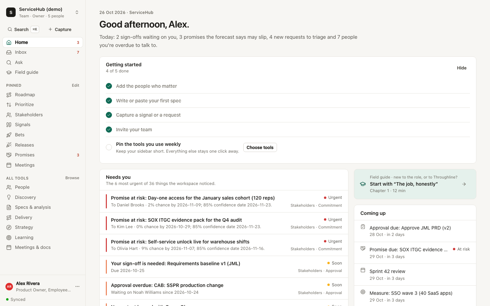
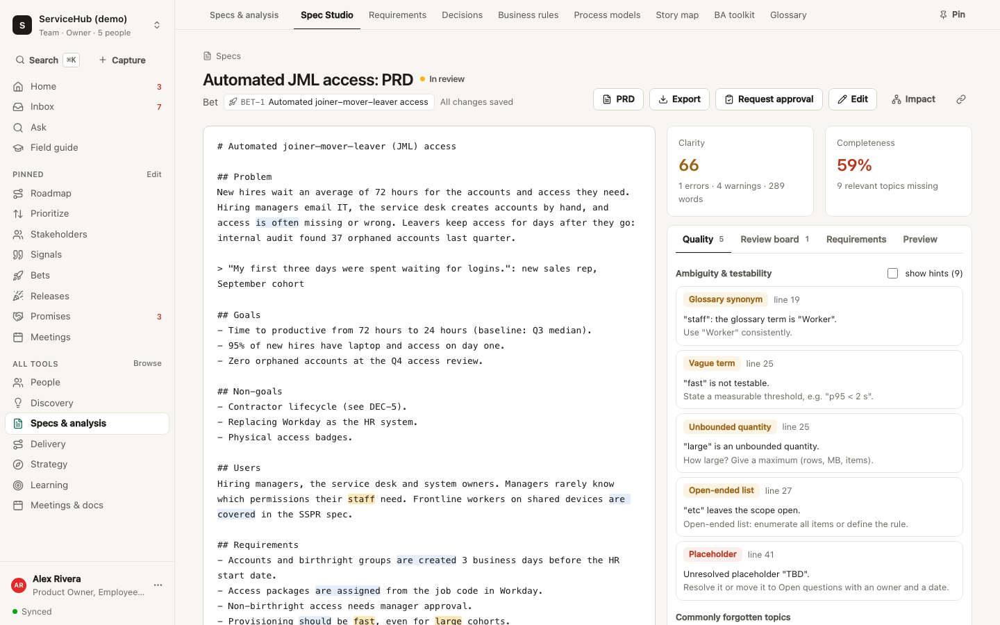
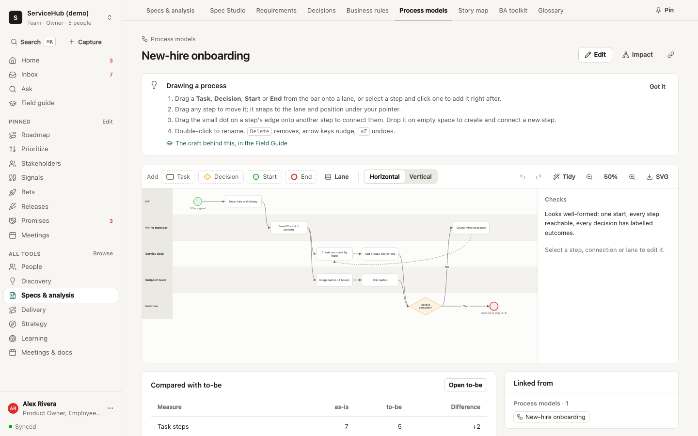
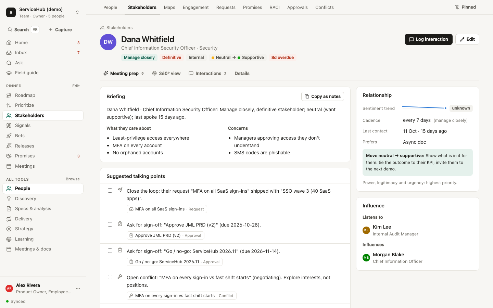
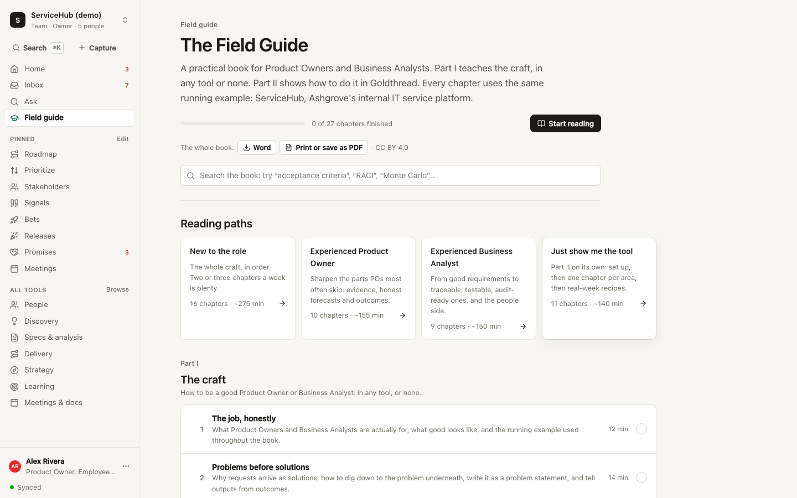

# Goldthread

**The working notebook for Product Owners and Business Analysts: on your own, or with your team.**

Goldthread keeps the chain *strategy → evidence → bet → requirement → story → release → outcome → learning* as one live graph, and wraps the people side of the job (stakeholders, approvals, promises, conflicts, communication) around it. It sits next to Jira, Azure DevOps or ServiceNow (the system of record for *work*) as the system of record for *intent* and *alignment*.

Every analysis runs locally on deterministic, explainable engines. Connect Claude or any OpenAI-compatible model for deeper reviews, or point your own AI assistant at it over MCP.

It comes with **The Field Guide**, a ~50,000-word book in [`book/`](book/), readable inside the app: Part I teaches the craft of being a good PO or BA, Part II teaches Goldthread.

> Concept, gap analysis and module map: [docs/CONCEPT.md](docs/CONCEPT.md) · Architecture and phases: [docs/BUILD_PLAN.md](docs/BUILD_PLAN.md) · Running it for a team: [docs/SELF_HOSTING.md](docs/SELF_HOSTING.md)



<table><tr>
<td></td>
<td></td>
</tr><tr>
<td></td>
<td></td>
</tr></table>

## Status

**Shared as-is, and not maintained.** This is a free, non-commercial project. Issues and pull requests are closed. If it's useful to you, fork it and make it yours: the licences below allow that.

Everything described here is built and covered by tests: 113 unit and integration tests, plus 14 browser tests that include accessibility scans. Some things have **never been tested against the real services**: email (SMTP), single sign-on, Jira Cloud, Azure DevOps, Slack, Microsoft Teams, inbound email, live AI model calls and the Docker image. Each was built against a local stand-in that follows the provider's documented API, so expect some fixing when you connect a real one. See [what has been tested](docs/SELF_HOSTING.md#what-has-been-tested).

**How it was made.** Goldthread, its tests and the Field Guide were written with substantial help from an AI model (Claude), directed and reviewed by the author. Read the code you rely on before you depend on it.

---

## Quick start

Requires **Node.js 24 or newer** (Goldthread uses Node's native TypeScript support and built-in SQLite: no build step for the server).

```bash
npm install
npm run dev
```

Open http://127.0.0.1:4300 and either:

- **Look around as someone on the demo team**: one click on the sign-in page. The demo is **ServiceHub**, an internal IT platform (SSO, access requests, joiner–mover–leaver automation, an ITSM migration) at a fictional company, with stakeholders from the CISO to the service desk, ~360 linked items, deliberate contradictions and gaps for the checks to find, and 12 weeks of delivery history. Five accounts show the roles: Alex (product owner, owner), Jordan (business analyst, editor), Priya (engineering lead, editor), Dana (CISO, viewer) and Kim (internal audit, viewer). The shared demo password is in `server/demo.ts`.
- **Create your own account**: pick whether you work mostly as a PO, a BA or both (this only sets your starting sidebar pins) and start from the IT sample, a SaaS sample (Ledgerly, a B2B payments product) or a blank workspace.

All sample dates are relative to today, so Home always has something to say.

Production:

```bash
npm run build && npm start
```

| Command | What it does |
|---|---|
| `npm run dev` | Server + Vite dev middleware with hot reload on :4300 |
| `npm start` | Serves the built PWA from `web/dist` |
| `npm test` | 113 tests: every engine, the store, accounts, roles and tokens, MCP, email, SSO, Jira/ADO sync, Slack/Teams, files, backups, sample integrity, PII redaction, the Field Guide's structure |
| `npm run e2e` | 14 browser tests in Chromium, including WCAG 2.1 AA scans in light and dark themes (after `npm run build`) |
| `npm run typecheck` | `tsc --noEmit` over core, server, CLI and web |
| `npm run seed` | Put the demo workspace back to its original content and exit |
| `npm run backup -- <folder>` | Consistent backup of all data, safe while the server runs |
| `npm run reset-password -- <email>` | Print a one-time password reset link (for operators) |

Configuration is by environment variables: port, data folder, public URL, signup policy, email, single sign-on and AI. They're all listed in [docs/SELF_HOSTING.md](docs/SELF_HOSTING.md). The demo accounts are only on under `npm run dev` (or `GT_DEMO=1`).

---

## Working as a team

- **Accounts and workspaces.** Everyone signs in with their own account. A workspace holds one product or programme; you can be in several and switch from the top of the sidebar. New accounts get a personal workspace.
- **Invites.** Admins create an invite link for an email address and a role (and optionally teams) under **Settings → People & access**. With email set up it's sent for them; otherwise they share it however they like. Links work once, for that address, for 14 days.
- **Signing in.** Passwords, or single sign-on with any OpenID Connect provider (Entra ID, Okta, Google, Auth0, Keycloak). Forgotten passwords are reset by email or with a one-time link from an admin.
- **Roles.** *Viewer* reads and comments (sponsors, auditors). *Editor* creates and edits. *Admin* also manages people, AI and imports. *Owner* also manages admins and can archive the workspace. The server enforces roles on every request; viewers see read-only screens.
- **Teams** group people inside a workspace and feed capacity planning and RACI.
- **Comments and @mentions** on every item; mentions land in the person's Inbox and, if they want, their email, along with sign-off requests and a weekly digest. Comments are always signed by the poster on the server.
- **No silent overwrites.** Two people editing the same item only clash if they changed the same field, and then the second person chooses which version to keep.
- **Files** can be attached to any item (up to 25 MB each).
- **Fields and item types of your own.** Add a *Vendor* to requirements, or a whole *Environments* type with its own list and form. They are validated like built-in fields and visible to AI assistants over MCP.
- **Your data is yours.** Anyone can download everything about themselves, or delete their account; their comments stay, attributed to "Former member".
- **Nothing is lost.** Deletes offer Undo, and editors can restore anything from **Settings → Data → Recently deleted**.
- **Live.** Changes from any person, the CLI, the extension or an AI assistant appear instantly for everyone, and every change is attributed in the activity trail.
- **Data layout.** `data/system.db` holds accounts, sessions, memberships, invites, hashed API tokens and the email queue; each workspace is its own SQLite file in `data/workspaces/`; uploads are in `data/files/`; `data/secret.key` encrypts stored AI keys and integration credentials. Back it up with `npm run backup`; never commit it.

---

## The Field Guide

A practical book for Product Owners and Business Analysts, in Markdown under `book/` and in the app under **Field guide** (`g f`):

- **Part I: The craft** (16 chapters): the job, problems before solutions, stakeholders, working relationships, discovery, strategy, elicitation, requirements, modelling, specs and reviews, prioritisation, forecasting, delivery and release, governance, learning from outcomes, growing in the role.
- **Part II: Working in Goldthread** (11 chapters): a tour, a first-week setup plan, one chapter per area, teams, connecting AI assistants, and recipes for a real week.
- **Appendices**: fill-in templates and a glossary.

Every chapter uses the same running example as the IT sample workspace (Ashgrove's ServiceHub), names the common traps, links to the tools it uses, and ends with interactive check-yourself questions. Reading paths cover new POs and BAs, experienced ones, and people who only want the tool. Progress is saved per person, Home shows a "continue reading" card, and tool guide panels link back to the chapter that teaches the craft behind them. Connected AI assistants can read chapters and quiz you over MCP.

---

## What's inside

The sidebar is short on purpose: **Home**, **Inbox**, **Ask**, **Field guide**, the tools you pinned, and seven sections. Each tool opens with tabs for the rest of its section, and a one-time "how this works" panel; jargon (RACI, WSJF, salience, baselines…) is explained on hover or focus. **All tools** lists everything in plain words, with pins.

**Home**: "My day": one sentence on what is waiting on you, the six most urgent things the workspace noticed (approvals waiting on you, promises at risk vs forecast, overdue touchpoints, cooling relationships, rising signal themes, untested leaps of faith, revisit-due decisions, high-exposure risks, failing UAT, measurements due; the full brief is one click away), people to reach with meeting prep, what is coming up, and a getting-started checklist for new workspaces. Inbox, Ask.

**Strategy**: Vision board & OKRs with progress and confidence · Metric tree & tracking plan · Business cases (NPV, ROI, payback, IRR, cost of delay, CD3) · Market (capability matrix vs competitors, win/loss) · Capacity (target vs actual allocation from real throughput, tech-debt register).

**Stakeholders**: Registry & 360° profiles · **Meeting prep** with generated talking points · Power/interest grid · Salience model · Engagement assessment matrix (current → desired, with suggested moves) · Influence network & "path to influence" · Cadence-based touchpoints and sentiment trends · Comms plan with overdue detection · Requests board with SLA and close-the-loop · **Promise ledger checked against the Monte Carlo forecast** · RACI with validation · Audit-grade approvals · Conflicts (positions vs interests) · Alignment check on decisions, bets and releases.

**Discover**: Signal Hub (TF-IDF theme clustering, trends, ARR, link suggestions, CSV import) · Opportunity tree with evidence strength & loud-customer detection · Bets · Assumption map · Experiment Lab (sample size, two-proportion z-test, CI) · Personas & journey maps · Research.

**Define**: **Spec Studio**: live ambiguity linter with inline highlights, completeness checker, a 10-role **Review Board**, requirement extraction, contradiction detection · Requirements with versions, baselines, word-level diffs and change requests with impact · Decision log (reversibility, revisit triggers) · Decision tables (gaps, overlaps, pairwise test generation) · **Visual process modeller**: drag shapes onto horizontal or vertical swimlanes, drag steps between lanes, drag to connect, inline rename, undo/redo, tidy-up, zoom, SVG export, keyboard control, live modelling checks (no start, dead ends, unreachable steps, unlabelled decision outcomes) and as-is/to-be comparison · State models (reachability, dead ends) · Story map with drag-and-drop slicing · BA toolkit (elicitation → extraction, use cases, data dictionary with PII, gap analysis, capability map, SWOT, 5 whys/fishbone) · Glossary enforcement.

**Deliver**: Backlog health (duplicates, stale, orphans, missing AC, cycles) with **live Jira Cloud / Azure DevOps sync** on a schedule (and optionally creating issues for stories written here), plus CSV import (stories, defects, resolved dates for the forecast; re-imports update by key) and export · Prioritization (RICE/WSJF + sensitivity analysis + ranking stability) · Roadmap (Now/Next/Later + timeline with forecast bands, internal/external views) · Releases (launch readiness, rollout & rollback, notes per audience) · Delivery pulse · RAID with risk heatmap · UAT & defects by root cause · Generated traceability matrix (CSV export) and impact analysis.

**Learn**: Bet ledger with calibration chart and Brier score · Feature catalog with removal candidates.

**Meetings & docs**: Meetings (notes or imported Teams/Zoom transcripts → decisions, actions, risks) · Document generator (PRD, BRD, PR/FAQ, steering pack, release notes, audience-specific updates) as Markdown, Word or print-ready PDF · Activity trail.

**Settings**: Profile, persona, notifications and your data · Workspace, custom fields and item types · People & access (invites, roles, teams, reset links) · Tokens & integrations (personal access tokens, copy-paste MCP/CLI/REST setup) · Jira, ADO & more (sync, Slack, Teams, email-in) · AI provider · Data (export, import, recently deleted).

Every one of the 53 item types (and any you add) also has generic create/edit/list/detail views with backlinks, comments and history, and a ⌘K palette searches everything. Press `c` anywhere for quick capture, `?` for shortcuts, and `g` then a letter to jump (`g h` Home, `g i` Inbox, `g f` Field guide…).

---

## Platforms

| Surface | How |
|---|---|
| **Web** | `npm run dev` / `npm start` |
| **Desktop & mobile** | Installable PWA (Chrome/Edge "Install app", Safari "Add to Dock" / "Add to Home Screen"). Responsive down to 375 px with a mobile tab bar; read-only offline from the last cached workspace. |
| **AI assistants (MCP)** | Claude Desktop, Claude Code, Cursor, VS Code or any MCP client: Streamable HTTP at `/mcp` with `Authorization: Bearer <token>`, or the stdio bridge `node mcp/stdio.ts` with `GT_URL` and `GT_TOKEN`. 17 tools: search, get/list items, daily brief, meeting prep, forecast, impact analysis, traceability gaps, spec checks, process-model checks, document generation, schema, the Field Guide (contents and chapters with quiz answers), and (with a write token) capture, create and update. **Settings → Tokens & integrations** shows ready-to-paste configs. |
| **CLI** | `node cli/goldthread.ts help`: `capture`, `brief`, `search`, `prep "<name>"`, `import <jira-or-ado.csv>` (schedule it to keep the backlog fresh), `export`, and `lint <spec.md>` which runs fully offline and exits 1 on errors (use it in CI). Set `GT_URL` and `GT_TOKEN`. |
| **Browser extension** | Load `extension/` unpacked in Chrome/Edge; right-click selected text → *Send to Goldthread as signal / request*. Guesses the source from the site (service desk, review site, CRM…). |
| **Slack & Teams** | Post new requests, sign-off requests, decisions and releases to a channel; capture with `/goldthread request: …` in Slack or by @mentioning an outgoing webhook in Teams. Requests are verified with Slack's signing secret or the Teams HMAC. |
| **Email in** | Forward an email to a private inbound address (Postmark, Mailgun or similar) and it becomes a signal, request, decision or risk, matched to the sender. |
| **REST API** | `POST /api/capture` for chat bots, scripts and alerts. Full CRUD under `/api/entities`, `/api/batch`, live changes over SSE at `/api/events`. Authenticate with `Authorization: Bearer <token>` (or `X-GT-Token`). |

Tokens are personal: create one per tool under **Settings → Tokens & integrations**, as read-only or read & write (capped by your role in that workspace). They are stored hashed and can be revoked at any time.

---

## AI (optional)

Each workspace chooses its own model under **Settings → AI** (admins):

- **Claude (Anthropic)**: `claude-opus-5-5` by default, structured JSON-schema outputs, server-side refusal fallbacks. Uses the key saved for the workspace, or `ANTHROPIC_API_KEY` from the server environment.
- **OpenAI-compatible**: any `/chat/completions` endpoint: OpenAI, Azure OpenAI, OpenRouter, Mistral, Groq, or a local Ollama / LM Studio / vLLM (one-click presets). Uses JSON-schema output where supported, JSON mode otherwise.
- **None**: every feature still works on the built-in engines.

This enables **deep review** in Spec Studio (the ten reviewer roles raise only questions the deterministic board didn't) and **Ask** answers with citations. Keys are encrypted at rest and never sent back to the browser; a *Test connection* button checks the setup. Emails, phone numbers and bank accounts are redacted before anything leaves the machine, and AI only proposes: nothing is written until you click.

Prefer your own assistant? Connect it over MCP instead (see Platforms): it then uses your assistant's model and subscription.

---

## Architecture

```
core/        platform-agnostic TypeScript: schema (53 item types + custom ones), Intent Graph, 25 engines
server/      Node HTTP server: accounts, sessions, roles, invites, tokens (system.db); one SQLite store per
             workspace with an append-only activity trail; REST + SSE; MCP; AI providers; email; OIDC;
             Jira/ADO sync; Slack, Teams and email-in; files; backups; IT and SaaS samples
mcp/         stdio bridge for MCP clients that launch local commands
web/         React PWA (hand-rolled design system, light/dark, charts per the data-viz palette)
book/        The Field Guide: Markdown chapters with front matter and quiz blocks
cli/         `goldthread` command: shares the core
extension/   Chrome/Edge MV3 capture extension
docs/        concept, build plan, self-hosting, accessibility, screenshots
e2e/         Playwright browser tests and accessibility scans
```

The graph is derived from typed reference fields in `core/schema.ts`, so traceability, impact analysis, backlinks and 360° profiles work for every entity type, including ones you add.

**Security:** see [SECURITY.md](SECURITY.md) for how data is protected. The project gets no security fixes, so whoever runs it is responsible for it. The server binds to `127.0.0.1` by default; put it behind HTTPS before exposing it ([docs/SELF_HOSTING.md](docs/SELF_HOSTING.md)).

**Accessibility:** WCAG 2.1 AA is the target. Automated scans and keyboard tests run on every change; screen-reader testing still needs people. See [docs/ACCESSIBILITY.md](docs/ACCESSIBILITY.md).

## Not built yet

SAML single sign-on (OIDC is built), ServiceNow sync, meeting bots that join calls, native desktop and mobile wrappers (the PWA installs on both), translations (English only for now), keyboard alternatives to drag and drop on boards, and real-time co-editing of the same text field (edits to different fields merge; the same field asks). These are good starting points for a fork.

## Licence

The code is licensed under the [Apache License 2.0](LICENSE). The Field Guide in [`book/`](book/) is licensed under [Creative Commons Attribution 4.0](book/LICENSE.md). The sample companies, people and data are fictional.
